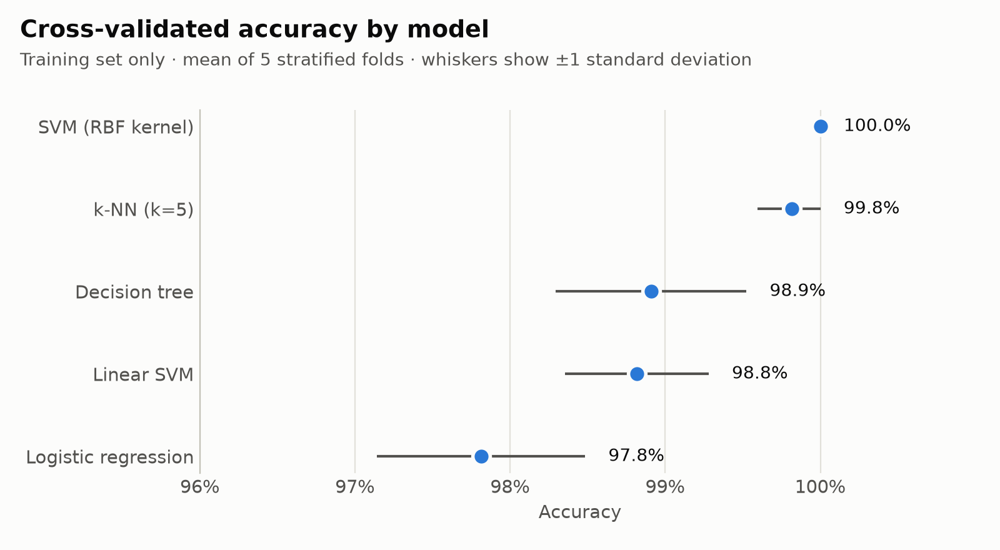
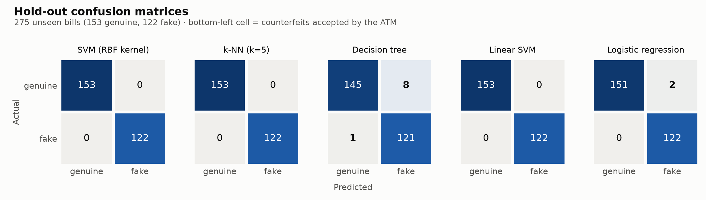
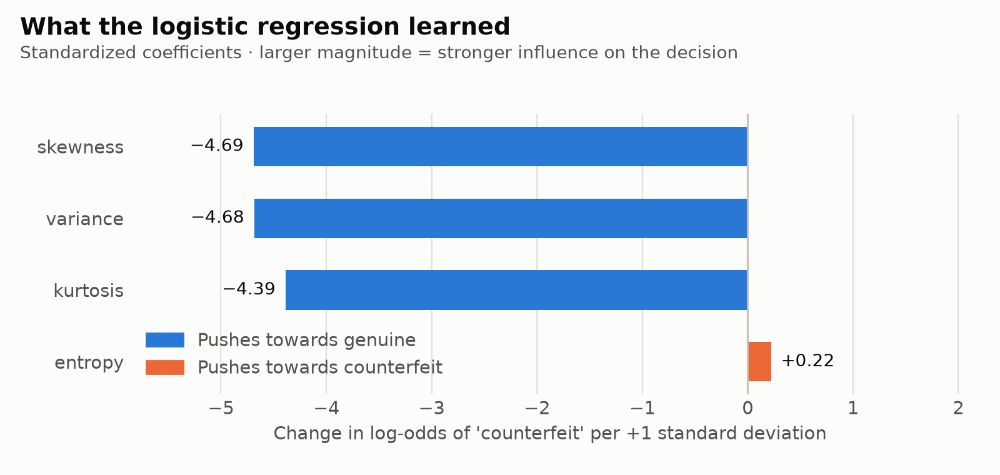
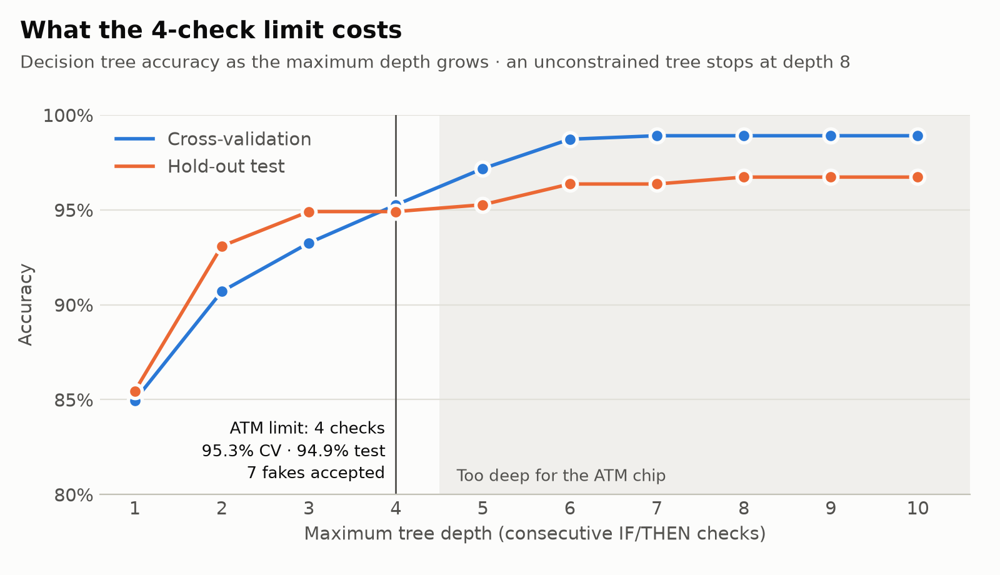
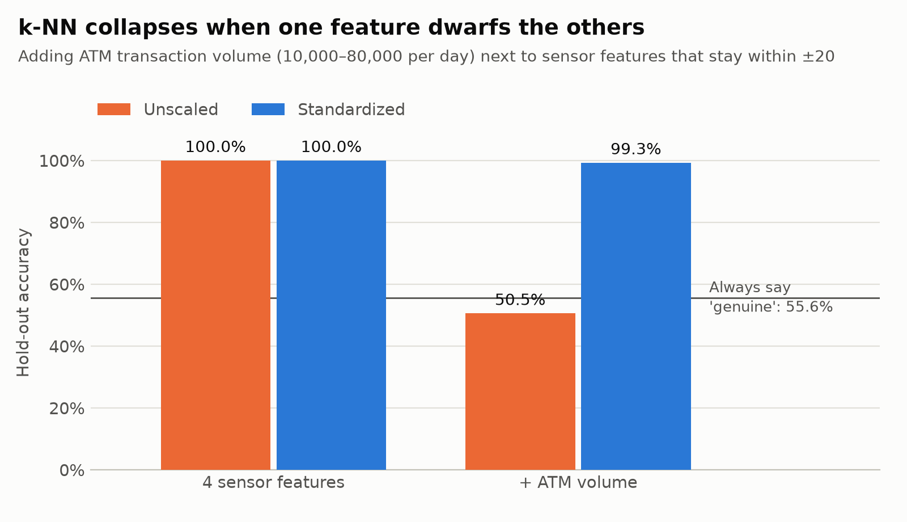
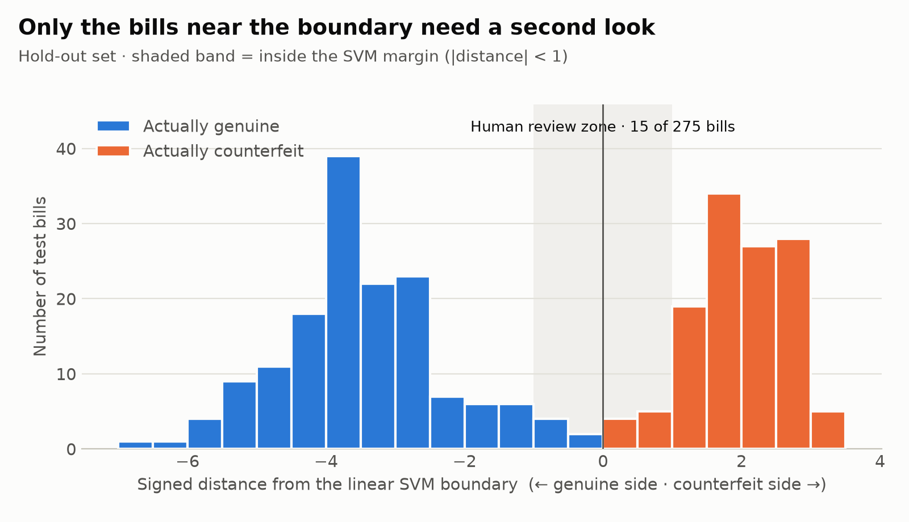

# Counterfeit Banknote Detection


Which machine learning model should an ATM use to reject counterfeit bills, given
that its microchip is slow, its decisions must be explainable, and a human security
team can only review a handful of bills?

This project trains and compares five classifiers on the UCI Banknote Authentication
dataset. It then looks at what each model costs once real constraints are applied:
a limit on how many IF/THEN checks the chip can run, a feature on a very different
scale that breaks distance-based models, and a review queue small enough for people
to work through.

## Key findings

| Question | Answer |
|---|---|
| Best model by cross-validation | **SVM with RBF kernel**: 100.0% accuracy on every fold, 0 counterfeits accepted on the test set |
| Cost of the ATM's 4-check limit | A depth-4 decision tree lets **7 of 122** test counterfeits through, against 1 for an unconstrained tree |
| Cheapest model with no misses | **Linear SVM / logistic regression**: 0 counterfeits accepted, and a prediction is just 4 multiply-adds and a comparison |
| Effect of an unscaled feature | Adding raw ATM volume drops k-NN from 100% to **50.5%**, below the 55.6% you get by always answering "genuine" |
| Human review workload | Only **15 of 275** test bills (5.5%) fall inside the SVM margin |

## The data

[Banknote Authentication](https://doi.org/10.24432/C55P57) (Lohweg, 2012), UCI Machine
Learning Repository. Grayscale images of genuine and forged banknote-like specimens
were taken with an industrial print-inspection camera. A wavelet transform turned each
image into four numbers:

| Feature | Meaning |
|---|---|
| `variance` | variance of the wavelet-transformed image |
| `skewness` | skewness of the wavelet-transformed image |
| `kurtosis` | kurtosis of the wavelet-transformed image |
| `entropy` | entropy of the image |

There are 1,372 bills: 762 labelled `0` and 610 labelled `1`. The UCI page does not say
which label is the forgery. This project follows the common convention that
**`1` = counterfeit**.

## Method

- **Stratified 80/20 split** (`random_state=0`): 1,097 bills for training and 275 for the
  test set (153 genuine, 122 counterfeit). The test set stands in for new bills and is
  scored only once per model.
- **Every model is a `Pipeline`** (`StandardScaler` → classifier), so the scaler is
  re-fit inside each fold and validation data never leaks into training.
- **Stratified, shuffled 5-fold cross-validation** on the training set only, scored on
  accuracy, precision, recall, F1 and ROC AUC.
- **The decision tree is not scaled.** Scaling never changes a tree's predictions, and
  leaving it out keeps the exported rules in the camera's own units.
- **Business-oriented metrics.** Next to accuracy, each model reports *counterfeits
  accepted* (false negatives, which cost the bank money) and *genuine bills rejected*
  (false positives, which annoy customers).

## 1. Model comparison



| Model | CV accuracy | CV recall (fakes) | Test accuracy | Fakes accepted | Genuine rejected |
|---|---|---|---|---|---|
| SVM (RBF kernel) | 100.0% ± 0.0 | 100.0% | 100.0% | 0 | 0 |
| k-NN (k=5) | 99.8% ± 0.2 | 100.0% | 100.0% | 0 | 0 |
| Decision tree (unconstrained) | 98.9% ± 0.6 | 99.2% | 96.7% | 1 | 8 |
| Linear SVM | 98.8% ± 0.5 | 99.4% | 100.0% | 0 | 0 |
| Logistic regression | 97.8% ± 0.7 | 99.4% | 99.3% | 0 | 2 |



The two classes are close to separable, so any reasonable model does well. The
differences that matter show up once the deployment constraints below are applied.

## 2. Explaining the baseline

Logistic regression is the explainable baseline. Because the features are
standardized, the coefficients can be compared directly:



`variance`, `skewness` and `kurtosis` all push strongly towards *genuine*. `entropy`
barely matters. The model is easy to explain, but that also makes it easy to game: a
linear model is monotonic. A counterfeiter who learns that higher image variance reads
as "genuine" can keep raising it, and the model has no notion of a value that is too
high to be real. In production, a linear model like this would need range checks or an
out-of-distribution detector next to it.

## 3. Deploying under the ATM's 4-check limit

The ATM firmware can evaluate at most **4 consecutive IF/THEN checks** before a
transaction times out. That is a decision tree with `max_depth=4`.



| Max depth | CV accuracy | Test accuracy | Fakes accepted | Genuine rejected |
|---|---|---|---|---|
| 3 | 93.3% | 94.9% | 6 | 8 |
| **4 (ATM limit)** | **95.3%** | **94.9%** | **7** | **7** |
| 5 | 97.2% | 95.3% | 1 | 12 |
| Unconstrained (reaches depth 8) | 98.9% | 96.7% | 1 | 8 |

The depth-4 tree is exported as plain rules that firmware engineers can implement
directly ([`reports/atm_rules.txt`](reports/atm_rules.txt)):

```text
|--- variance <= 0.274
|   |--- skewness <= 7.565
|   |   |--- variance <= -0.459
|   |   |   |--- kurtosis <= 6.216
|   |   |   |   |--- class: counterfeit
...
```

**Recommendation.** Allowing a fifth check cuts accepted counterfeits on the test set
from 7 to 1, at the cost of rejecting 12 genuine bills instead of 7. If the chip can do
four multiply-adds and one comparison, a linear model is a better choice than any of
these trees. The decision only needs the sign of `w · x + b` (the scaler's mean and
standard deviation fold into `w` and `b`), so no exponential is ever computed, and it
accepted 0 counterfeits on the test set.

## 4. Why scaling matters for distance-based models

Suppose the operations team adds a new column, `atm_volume`: the number of transactions
the ATM handles per day, from 10,000 to 80,000. It carries no information about the bill.



| Features | Unscaled | Standardized |
|---|---|---|
| 4 sensor features | 100.0% | 100.0% |
| + ATM volume | **50.5%** (71 fakes accepted) | 99.3% (1 fake accepted) |

The sensor features stay within about ±20, while volume differences run into the tens of
thousands. In a Euclidean distance the volume term swamps the rest, so k-NN ends up
finding the bills whose ATM had similar traffic. That is worse than always answering
"genuine" (55.6%). Standardizing inside the pipeline brings performance back.

## 5. Human-in-the-loop review

A linear SVM's decision function measures how far each bill sits from the boundary.
Bills inside the margin (|distance| < 1) are the ones the model is least sure about,
so they are sent to the security team instead of all 275.



**15 of 275 test bills (5.5%)** land in the review zone. The full list, sorted closest to
the boundary first, is in [`reports/borderline_bills.csv`](reports/borderline_bills.csv).
The linear SVM made no mistakes on this test set, so here the review queue is a safety
net. These 15 bills are where an error would be most likely.

## Limitations

- **Small, nearly separable dataset.** 0 misses out of 122 test counterfeits does not
  mean zero misses in production. By the rule of three, the 95% upper bound on the miss
  rate is still about 3/122 ≈ 2.5%.
- **Lab images, not ATM scans.** The specimens were photographed under controlled
  conditions. Real scanner noise, worn bills and new forgery techniques would shift the
  distribution.
- **Simulated volume.** `atm_volume` is random by design, to isolate the scaling effect.
- **Label convention.** The meaning of `0`/`1` comes from common usage, not from the
  dataset's documentation.

## How to run

```bash
git clone https://github.com/<your-username>/banknote-counterfeit-detection.git
cd banknote-counterfeit-detection
python -m venv .venv
source .venv/bin/activate        # Windows: .venv\Scripts\activate
pip install -e ".[dev]"

banknote all                     # downloads the data on first run, writes everything to reports/
banknote depth --cv 10           # or run a single experiment: compare | explain | depth | scaling | review
pytest                           # 26 tests on synthetic data, no network needed
```

`python -m banknote` works too. A guided walkthrough is in
[`notebooks/walkthrough.ipynb`](notebooks/walkthrough.ipynb).

## Project structure

```text
banknote-counterfeit-detection/
├── src/banknote/
│   ├── config.py        # schema, data URLs, seeds, business constraints
│   ├── data.py          # download + validation + stratified split
│   ├── models.py        # model factory: every model is a scikit-learn Pipeline
│   ├── evaluate.py      # cross-validation and hold-out metrics in business terms
│   ├── experiments.py   # the case-study questions as pure functions
│   ├── plots.py         # figures (each has a CSV twin in reports/metrics)
│   ├── report.py        # runs experiments, writes CSV / PNG / JSON
│   └── cli.py           # `banknote` command
├── tests/               # pytest suite (data, models, experiments)
├── notebooks/           # walkthrough notebook
├── reports/             # generated: figures, metrics, ATM rules, review list, summary.json
└── .github/workflows/   # CI: lint + tests on every push
```

## Data source and license

Lohweg, V. (2012). *Banknote Authentication* [Dataset]. UCI Machine Learning Repository.
https://doi.org/10.24432/C55P57. Licensed under CC BY 4.0.

The data is not stored in this repository. It is downloaded from UCI on first run, with
a public mirror as fallback. The code is released under the [MIT License](LICENSE).
